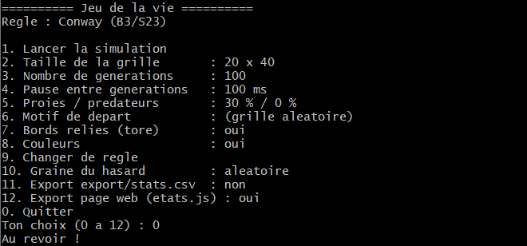
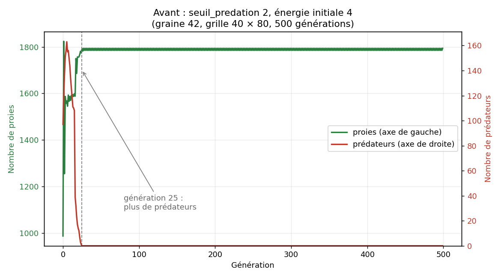
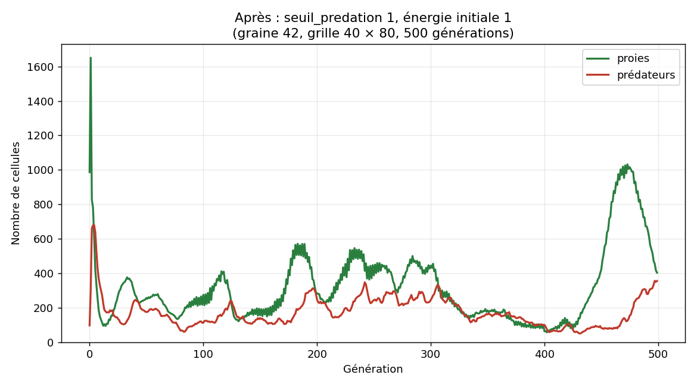
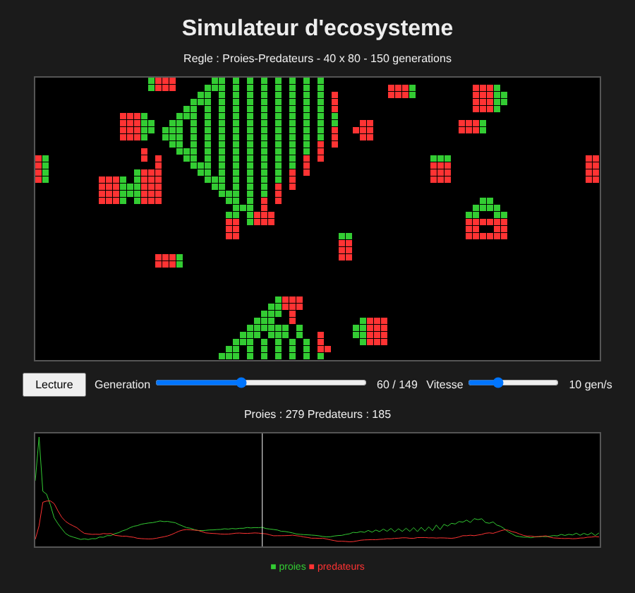

# Jeu de la vie Proies/Prédateurs

Automate cellulaire proies/prédateurs écrit en C (SAE L2 Informatique).

Le programme simule d'abord le jeu de la vie de Conway (règle B3/S23), puis
des règles modifiables (notation B/S, fichiers `.txt`) et enfin un modèle
proies/prédateurs. L'affichage se fait en texte dans le terminal, et un menu
permet de tout régler sans recompiler.

## Équipe

| Membre | Rôle | Fichiers responsables | Binôme de secours |
|---|---|---|---|
| Wissam ABASSE | Coordinateur | `main.c`, `menu.c` | John-Lucas |
| John-Lucas BOYER | Distributeur | `affichage.c`, `io.c`, `Makefile`, `motifs/`, `web/` | Wissam |
| Elamine HOUSSENI | Producteur | `grille.c`, `simulation.c`, `tests/` | Nizar |
| Nizar AHMED ATTOUMANI | Éditeur | `regles.c`, `regles/`, `docs/` | Elamine |

## Arborescence

- `include/` : fichiers d'en-tête (`.h`), les déclarations des fonctions
- `src/` : code source (`.c`)
- `regles/` : fichiers de règles (une règle par fichier)
- `motifs/` : grilles de départ (planeur, clignotant, bloc)
- `tests/` : tests automatiques
- `export/` : fichiers générés par le programme
- `web/` : page web (bonus)
- `docs/` : journal de bord, journal IA, expériences, rapport

## Compilation

### Prérequis

- `gcc` (C99) et `make` (sous Windows : MinGW, la commande s'appelle `mingw32-make`)
- un terminal qui comprend les couleurs ANSI (Git Bash, terminal Linux ou macOS)
- `valgrind` (facultatif, Linux ou WSL) pour vérifier la mémoire

### Compiler

```bash
make            # compile le programme "simulation"
make clean      # efface les fichiers de compilation (.o, simulation, test_bin)
```

Options de compilation : `-Wall -Wextra -std=c99 -g -Iinclude` (aucun avertissement accepté).

## Utilisation

```bash
./simulation                        # ouvre le menu
./simulation motifs/planeur.txt     # ouvre le menu avec le planeur déjà choisi comme motif
```

`make run` compile puis lance `./simulation`.

### Le menu

```text
========== Jeu de la vie ==========
Regle : Conway (B3/S23)

1. Lancer la simulation
2. Taille de la grille       : 20 x 40
3. Nombre de generations     : 100
4. Pause entre generations   : 100 ms
5. Proies / predateurs       : 30 % / 0 %
6. Motif de depart           : (grille aleatoire)
7. Bords relies (tore)       : oui
8. Couleurs                  : oui
9. Changer de regle
10. Graine du hasard         : aleatoire
11. Export export/stats.csv  : non
12. Export page web (etats.js) : non
0. Quitter
```

| Choix | Effet | Valeurs acceptées |
|---|---|---|
| 1 | lance la simulation ; le menu revient à la fin | — |
| 2 | taille de la grille aléatoire | 5 à 100 lignes, 5 à 200 colonnes |
| 3 | nombre de générations | 1 à 10 000 |
| 4 | pause entre deux générations | 0 à 2 000 ms |
| 5 | pourcentage de proies, puis de prédateurs, au départ (la somme ne dépasse pas 100 %) | 0 à 100 % |
| 6 | fichier motif (vide = grille aléatoire) | ex. `motifs/planeur.txt` |
| 7 | bords reliés (tore) oui / non | — |
| 8 | couleurs oui / non | — |
| 9 | changer de règle (voir plus bas) | — |
| 10 | graine du hasard : la même graine donne toujours la même grille de départ (0 = différente à chaque lancement) | 0 à 1 000 000 |
| 11 | écrit `export/stats.csv` (populations) pendant la simulation | oui / non |
| 12 | écrit `export/etats.txt` et `export/etats.js` pour la page web | oui / non |
| 0 | quitter | — |

Une saisie invalide (lettres, nombre hors limites, ligne vide) ne fait pas planter
le programme : le menu affiche « Valeur invalide, recommence. » et repose la question.



Affichage : `.` = case vide, `o` = proie (vert), `X` = prédateur (rouge).
Sous la grille : numéro de génération, nombre de proies et de prédateurs,
nom de la règle et sa notation B/S.

Conseil sous Windows : si l'affichage est lent, mettre les couleurs à « non » (choix 8)
et agrandir la fenêtre du terminal.

### Changer de règle (choix 9)

```text
1. Une regle du catalogue
2. Un fichier de regles (ex. regles/highlife.txt)
3. Taper une regle B/S (ex. B36/S23)
0. Retour
```

Si la règle est invalide, le programme l'annonce et garde l'ancienne.

**Le catalogue** contient 7 règles :

| N° | Règle | Ce qu'on observe |
|---|---|---|
| 1 | Conway (B3/S23) | la règle classique : planeurs, oscillateurs, formes stables |
| 2 | HighLife (B36/S23) | comme Conway, avec en plus des « réplicateurs » |
| 3 | Seeds (B2/S) | explosion : aucune cellule ne survit, mais beaucoup naissent |
| 4 | Day & Night (B3678/S34678) | vivant et vide se comportent de la même façon |
| 5 | Maze (B3/S12345) | les cellules dessinent des couloirs, comme un labyrinthe |
| 6 | Life without Death (B3/S012345678) | une cellule vivante ne meurt jamais |
| 7 | Proies-Predateurs | le modèle proies/prédateurs (voir plus bas) |

### La notation B/S

`B` (*born*) donne les nombres de voisins qui font **naître** une cellule sur une case vide,
`S` (*survive*) ceux qui la font **survivre**. On compte les 8 cases autour (voisinage de Moore).

Exemple : `B36/S23` = une case vide naît avec 3 ou 6 voisins, une cellule survit avec 2 ou 3 voisins.
`B2/S` (rien après le S) = aucune cellule ne survit.

### Format d'un fichier de règles

Une ligne `cle=valeur` par paramètre ; les lignes vides et celles qui commencent par `#` sont ignorées.

Jeu de la vie (`mode=vie`) :

```text
# HighLife : comme Conway, mais une case vide nait aussi avec 6 voisins
nom=HighLife (B36/S23)
mode=vie
bs=B36/S23
```

Proies/prédateurs (`mode=pp`) : les six paramètres sont obligatoires.

```text
nom=Proies-Predateurs
mode=pp
proie_naissance=2-3
proie_survie=1-5
seuil_predation=1
pred_energie_init=1
pred_gain=2
pred_age_max=15
```

Un fichier est refusé s'il manque une clé, si une valeur est fausse (`2-3x`, `-1`, `9`),
ou s'il mélange les deux modes (`bs` en mode `pp`, ou une clé proies/prédateurs en mode `vie`).

Fichiers fournis dans `regles/` : `conway.txt`, `highlife.txt`, `seeds.txt`, `day_night.txt`,
`maze.txt`, `life_without_death.txt`, `proies_predateurs.txt`.

### Le modèle proies/prédateurs

À chaque génération, chaque case regarde ses 8 voisines : `P` proies et `D` prédateurs.

| Case | Ce qui se passe |
|---|---|
| vide | devient une **proie** si `D = 0` et `P` est dans `proie_naissance` |
| proie | **mangée** si `D ≥ seuil_predation` : elle devient un prédateur (énergie `pred_energie_init`) ; sinon elle **survit** si `P` est dans `proie_survie`, et meurt sinon |
| prédateur | perd 1 d'énergie, gagne `pred_gain` s'il a au moins une proie voisine ; il **meurt** si son énergie tombe à 0 ou s'il dépasse `pred_age_max` générations |

La prédation est testée **avant** la survie : une proie entourée de prédateurs est mangée,
même si elle a le bon nombre de proies voisines.

**Paramètres retenus** (`regles/proies_predateurs.txt`), trouvés par les essais de `docs/experiences.md` :

| Paramètre | Valeur | Sens |
|---|---|---|
| `proie_naissance` | 2-3 | une case vide devient une proie avec 2 ou 3 proies voisines (et aucun prédateur) |
| `proie_survie` | 1-5 | une proie survit avec 1 à 5 proies voisines |
| `seuil_predation` | 1 | un seul prédateur voisin suffit pour manger la proie |
| `pred_energie_init` | 1 | énergie d'un nouveau prédateur |
| `pred_gain` | 2 | énergie gagnée quand il a au moins une proie voisine |
| `pred_age_max` | 15 | âge maximal d'un prédateur, en générations |

Avec `seuil_predation = 2` et `pred_energie_init = 4`, les prédateurs disparaissaient très tôt ;
avec 1 et 1, les deux espèces sont encore là après 500 générations (grille 40 x 80, graine 42 :
403 proies et 355 prédateurs). Les courbes : `docs/courbe_avant.png` et `docs/courbe_apres.png`.




Pour changer les paramètres, il suffit de modifier `regles/proies_predateurs.txt`
et de le charger avec le choix 9 → 2, sans recompiler.

### Exports et page web

- **Choix 11** : `export/stats.csv` (colonnes `generation,proies,predateurs`), à ouvrir dans un tableur
  (Excel : Données → À partir d'un fichier texte/CSV, séparateur virgule) pour tracer la courbe.
- **Choix 12** : `export/etats.txt` (toutes les générations en texte) puis `export/etats.js`,
  lu par la page web.

Pour voir l'animation : lancer `./simulation`, mettre le choix 12 à « oui », lancer (choix 1),
puis **double-cliquer sur `web/index.html`**. La page propose lecture/pause, une vitesse,
un curseur de génération et la courbe des populations. Le fichier est en `.js` et non en `.json`
parce qu'un navigateur refuse de lire un fichier local avec `fetch()` quand on ouvre la page par double-clic.

Le dossier `export/` n'est pas dans GitHub : chaque ordinateur doit créer `etats.js` en lançant la simulation
avec le choix 12. Si on ouvre la page avant, elle affiche en rouge « Fichier export/etats.js introuvable » :
il suffit de lancer la simulation, puis de recharger la page (F5).



### Format d'un motif

Première ligne : nombre de lignes et de colonnes. Ensuite, une ligne de texte par ligne de grille :
`.` = vide, `o` = proie, `X` = prédateur.

```text
5 5
.....
.....
.ooo.
.....
.....
```

## Fonctionnement interne

- **Deux grilles** allouées dynamiquement (`Cellule **`) : on lit l'une, on écrit dans l'autre,
  puis on **échange les pointeurs**. Aucune copie de grille à chaque génération.
- **Tore** : avec les bords reliés, la case à droite de la dernière colonne est la première
  (calcul avec le modulo). Le planeur qui sort à droite revient à gauche.
- **Règles** : une structure `Regles` (mode, tableaux `naissance[9]` et `survie[9]`, paramètres
  proies/prédateurs). Le moteur appelle `appliquer_regle` pour chaque case, sans connaître la règle.
- **Mémoire** : chaque `creer_grille` a son `detruire_grille` ; valgrind ne signale aucune fuite.

## Tests

```bash
make test       # compile et lance chaque fichier tests/test_*.c, s'arrête au premier échec
make valgrind   # lance le programme sous valgrind (Linux ou WSL)
```

| Fichier de test | Ce qu'il vérifie |
|---|---|
| `tests/test_grille.c` | création, copie, vidage et libération d'une grille |
| `tests/test_voisins.c` | comptage des voisins, avec et sans tore ; remplissage aléatoire |
| `tests/test_regles.c` | les 18 cas de Conway (0 à 8 voisins, case vide ou vivante) |
| `tests/test_regles_bs.c` | lecture de la notation B/S, chaînes invalides refusées |
| `tests/test_regles_fichier.c` | lecture des fichiers de règles `mode=vie` |
| `tests/test_catalogue.c` | les 7 règles du catalogue |
| `tests/test_regles_pp.c` | les 12 cas de la règle proies/prédateurs |
| `tests/test_regles_pp_fichier.c` | lecture des fichiers `mode=pp`, fichiers incomplets ou mélangés refusés |
| `tests/test_pp.c` | proies/prédateurs sur une vraie grille, énergie de départ des prédateurs |
| `tests/test_simulation.c` | bloc stable, clignotant, planeur sur le tore, statistiques |
| `tests/test_io.c` | lecture des motifs, fichier introuvable |
| `tests/test_affichage.c` | notation B/S et ligne de statistiques |
| `tests/test_couleurs.c` | codes couleur ANSI avec couleurs, aucun sans |
| `tests/test_menu_regles.c` | choix 9 du menu (catalogue, fichier, B/S, règle invalide) |
| `tests/test_export_stats.c` | export `stats.csv` : en-tête, lignes, fichier `NULL` |
| `tests/test_export_etats.c` | export `etats.txt` puis conversion en `etats.js` ; fichier absent, coupé ou faux refusé |
| `tests/test_menu_pp.c` | choix 5 et 10 du menu (proportions, graine) |
| `tests/test_menu_export.c` | choix 11 et 12 du menu (exports oui / non) |

## Avancement

- **v0.1** : jeu de la vie de Conway dans le terminal, grille aléatoire ou motif, tests automatiques.
- **v0.2** : règles modifiables (notation B/S, fichiers de règles, catalogue de 6 règles), menu de choix de la règle.
- **v0.3** : modèle proies/prédateurs (7e règle, paramètres dans les fichiers), proportions et graine dans le menu,
  export `stats.csv`, paramètres où les deux espèces coexistent, courbes avant / après.
- **Bonus web** : export des états (`etats.txt`, `etats.js`) et page `web/index.html`.
- **v1.0** : vérification mémoire de tous les modes (`docs/valgrind.md`), commentaires de toutes les fonctions, README complet.

## Documentation

- `docs/journal_de_bord.md` : décisions et organisation de l'équipe
- `docs/journal_ia.md` : utilisation de l'IA (prompts, ce qui a marché ou non)
- `docs/experiences.md` : essais des règles (population après N générations)
- `docs/valgrind.md` : résultats de valgrind sur tous les modes (0 fuite)
- `docs/courbe_avant.png`, `docs/courbe_apres.png` : courbes des populations proies / prédateurs
